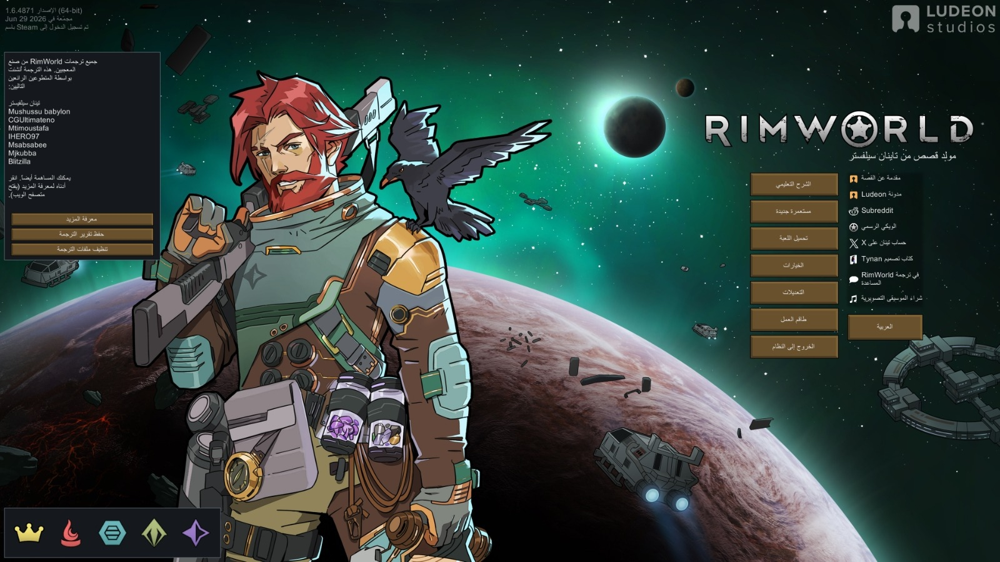
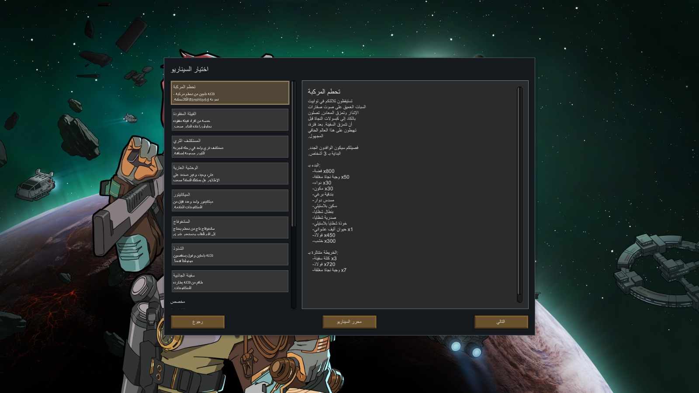
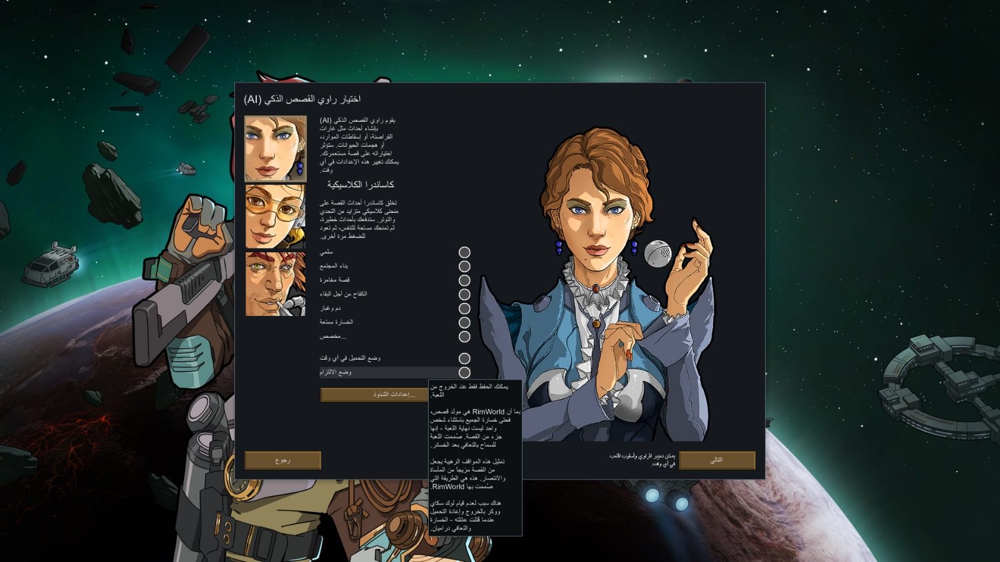
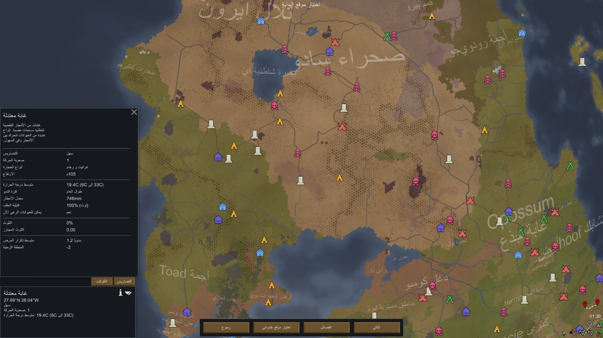
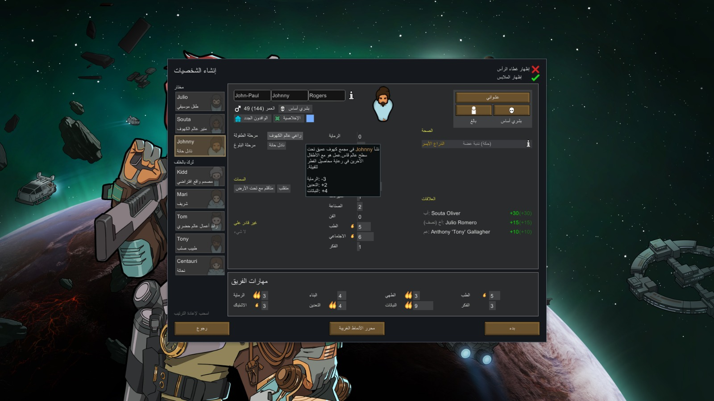
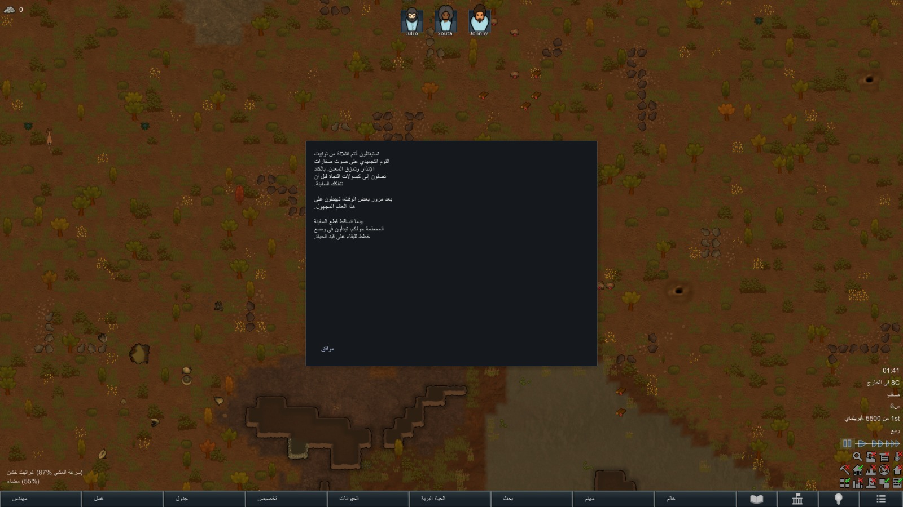
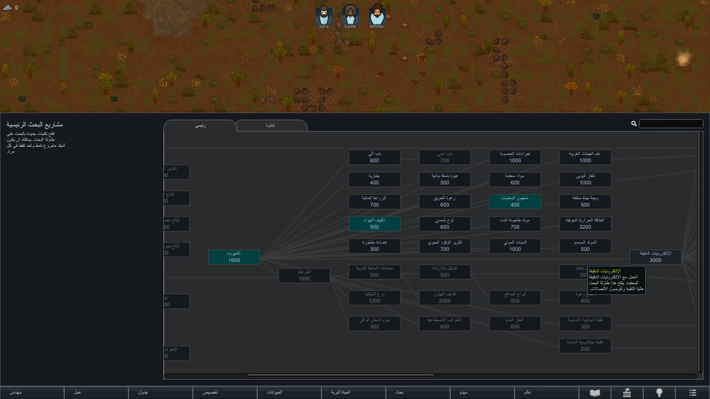
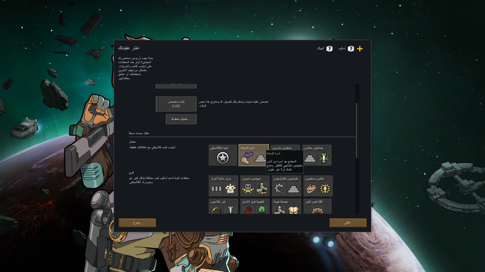

# تعريب لعبة RimWorld | اللغة العربية

  🇮🇶 <a href="#arabic">العربية</a> |
  🇬🇧 <a href="#english">English</a>

  
  
  
  
  

**مود دعم اللغة العربية:** [مستودع GitHub](https://github.com/MushussuBabylon/ArabicSupport)  
**تنزيل التعريب:** [تنزيل أحدث إصدار](https://github.com/MushussuBabylon/RimWorld-ar/releases/tag/latest-release)

تعريب شامل للعبة **RimWorld**، يشمل اللعبة الأساسية وجميع الإضافات الرسمية.

يجمع مود `ArabicSupport` بين ملفات التعريب ودعم عرض النصوص العربية، بما في ذلك اتصال الحروف والخطوط وتنسيق النصوص والتفاف الأسطر.

---

## لقطات من داخل اللعبة (Screenshots)

 

 

 

 

 

 

 

 

---

## طريقة التثبيت

1. حمّل [أحدث إصدار](https://github.com/MushussuBabylon/RimWorld-ar/releases/tag/latest-release).
2. فك ضغط `ArabicSupport.zip` مباشرة داخل مجلد اللعبة الرئيسي `RimWorld`.
3. فعّل مود `ArabicSupport` من قائمة المودات داخل اللعبة (يتطلب مود `Harmony`). ويمكنك أيضاً تفعيل `Arabic Auto Translation` لترجمة المودات الأخرى.
4. اختر اللغة العربية من قائمة اختيار اللغة داخل اللعبة.

### المسارات الافتراضية

**Steam:**
`C:\Program Files (x86)\Steam\steamapps\common\RimWorld`

**GOG:**
`C:\GOG Games\RimWorld`

---

## المترجم

  <strong>ترجمة وتعريب</strong> 
  <strong>Mushussu Babylon</strong>

---

## التعريب في Nexus Mods

[زيارة صفحة التعريب](https://www.nexusmods.com/rimworld/mods/757)

---

## المساهمة والإبلاغ عن الأخطاء

للمساهمة في تحسين التعريب، يمكنك فتح بلاغ أو تقديم طلب دمج، مع إرفاق المعلومات التالية:

- **النص الحالي:** النص الذي ترغب في تغييره.
- **الترجمة المقترحة:** البديل الذي تراه مناسباً.
- **صورة توضيحية:** لقطة من داخل اللعبة توضح موضع النص.

تُراجع الاقتراحات وتُدرج التعديلات المناسبة في التحديثات الدورية. يُبنى إصدار جديد ويُنشر تلقائياً كل يوم جمعة، أو يدوياً عند الحاجة.

---

**شكراً لدعمكم ومساهمتكم!**

[⬆ العودة إلى اختيار اللغة](#languages)

---

# 🇬🇧 RimWorld Arabic Translation

A comprehensive Arabic translation for **RimWorld**, covering the base game and all official DLCs.

`ArabicSupport` combines the translation with Arabic language support, including connected letters, custom fonts, text formatting, and line wrapping.

**ArabicSupport Mod:** [GitHub Repository](https://github.com/MushussuBabylon/ArabicSupport)  
**Download Translation:** [Download Latest Release](https://github.com/MushussuBabylon/RimWorld-ar/releases/tag/latest-release)

---

## In-Game Screenshots (ArabicSupport)

[View the screenshot gallery](#screenshots).

---

## Installation

1. Download the [latest release](https://github.com/MushussuBabylon/RimWorld-ar/releases/tag/latest-release).
2. Extract `ArabicSupport.zip` directly into your main `RimWorld` game directory.
3. Enable `ArabicSupport` from the in-game Mods menu (requires `Harmony`). You can also enable `Arabic Auto Translation` to translate other mods.
4. Select Arabic from the in-game language selection menu.

### Default Installation Paths

**Steam:**
`C:\Program Files (x86)\Steam\steamapps\common\RimWorld`

**GOG:**
`C:\GOG Games\RimWorld`

---

## Translator

  <strong>Translated and maintained by</strong> 
  <strong>Mushussu Babylon</strong>

---

## Find the Translation on Nexus Mods

[Visit the Nexus Mods page](https://www.nexusmods.com/rimworld/mods/757)

---

## Contributions and Bug Reports

To help improve the translation, open an Issue or submit a Pull Request with:

- **Original Text:** The text you want to change.
- **Suggested Translation:** Your proposed alternative.
- **Screenshot:** An in-game image showing the text.

Suggestions are reviewed and suitable changes are included in future updates. New releases are automatically built and published every Friday or manually when needed.

---

**Thank you for your support and contributions!**

[⬆ Back to language selection](#languages)
